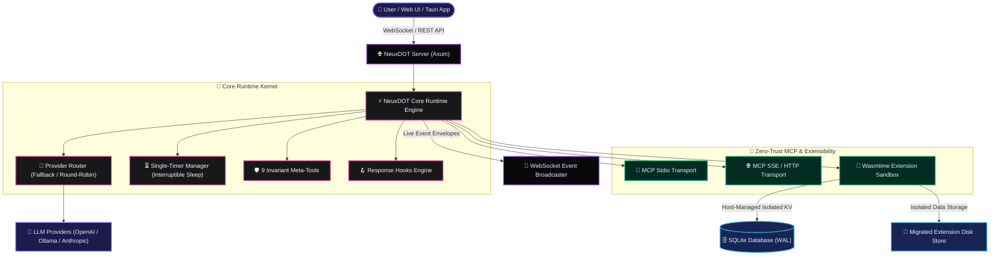

<div align="center">


<br/>

```text
✧･ﾟ: *✧･ﾟ:* 🌸 *:･ﾟ✧*:･ﾟ✧ ─── ･ ｡ﾟ☆: *.☽ .* :☆ﾟ. ─── ✧･ﾟ: *✧･ﾟ:* 🌸 *:･ﾟ✧*:･ﾟ✧
```

[](https://www.rust-lang.org/)
[](https://tauri.app/)
[-FF3E00.svg?style=for-the-badge&logo=svelte&logoColor=white)](https://svelte.dev/)
[](https://wasmtime.dev/)
[](https://www.sqlite.org/)
[](https://modelcontextprotocol.io/)
[](LICENSE)
[](#-the-neuxdot-paradigm)

<br/>

> ### 🌸 (｡•̀ᴗ-)✧ *“Zero-trust determinism never looked so cute!”*
> **NeuxDOT** is an ultra-fast, cache-invariant, zero-trust MCP-native agent runtime & desktop platform. Built for developers who demand **100% deterministic prompt prefix caching**, surgical **invariant meta-tools**, sandboxed **Wasmtime WebAssembly extensions**, and real-time **unprompted event streaming**.

<br/>

**[ 🎬 Apple-Style Promo ](#-apple-style-ui-animation--kinetic-promo)** &nbsp;•&nbsp;
**[ 🌸 The Paradigm ](#-the-neuxdot-paradigm)** &nbsp;•&nbsp;
**[ 🏛️ Architecture ](#-system-architecture)** &nbsp;•&nbsp;
**[ ✨ 9 Meta-Tools ](#-9-invariant-meta-tools)** &nbsp;•&nbsp;
**[ 🧩 WASM Sandbox ](#-sandboxed-wasm-extensions)** &nbsp;•&nbsp;
**[ 🪝 Response Hooks ](#-transparent-response-hooks--handlebars)** &nbsp;•&nbsp;
**[ 🚀 Quick Start ](#-quick-start)** &nbsp;•&nbsp;
**[ 🛠️ Extension Guide ](#-building-wasm-extensions)**

<br/>

</div>

---

## 🎬 Apple-Style UI Animation & Kinetic Promo

Experience NeuxDOT's cache-invariance, 3D isometric runtime architecture, and sandboxed WASM extensions in an Apple-style kinetic product reveal:

<div align="center">

[](video.html)

<br/>

[🚀 **Open Apple-Style UI Animation (`video.html`)**](video.html) &nbsp;&nbsp;|&nbsp;&nbsp; 
[🎥 **Assets Mirror (`assets/video.html`)**](assets/video.html)

<br/>

</div>

## ⚡ The NeuxDOT Paradigm

Traditional agent architectures dump volatile tool JSON schemas, dynamic server updates, and unformatted state directly into the system prompt. Every turn breaks LLM prefix caches, ballooning token bills and injecting multi-second latency penalties.

```
Traditional Framework:
[ Volatile System Prompt (Tool Schemas + Server State) ] ➔ 💥 Cache Miss Every Turn!

NeuxDOT Architecture:
[ ❄️ Invariant Static Prompt + 9 Meta-Tools ] ➔ ⚡ 100% Cache Hit Across All Turns!
```

NeuxDOT eliminates this flaw at the runtime kernel layer:

* ⚡ **100% Cache-Invariance**: System prompts and tool signatures never change across turns. The model pulls external schemas dynamically on-demand using invariant meta-tools.
* 🛡️ **Zero-Trust Tool Discovery**: External MCP endpoints and tools disabled by policy are completely masked from the LLM. Zero prompt leakage.
* 🌸 **Unprompted Event Push Streams**: True asynchronous MCP push notifications (`notifications/resources/updated`) stream live updates directly into context without busy-wait polling.
* 🧩 **Sandboxed WASM Extensibility**: Isolated WebAssembly extensions running inside Wasmtime with host-managed Key-Value stores and seamless data migration between versions.
* ⏳ **Single-Timer Deterministic Sleeping**: Native `sleep(duration)` with timer supersedence, cancellation guarantees, and instant wake-up on push events.
* 🎀 **Pure Handlebars Templating**: No hardcoded system prompt injections. Complete user control over prompt structure and memory formatting.
* 🪝 **Transparent Response Hooks**: Custom message telemetry evaluated with `{{time}}` and `{{context_remaining}}` injected into every tool execution event.

---

## 🏛️ System Architecture



---

## 🎯 Sparkling Features

### 1. 🛡️ 9 Invariant Meta-Tools (Cache-Stability Guarantee)

NeuxDOT never inlines sprawling JSON schemas. The model communicates with the world through 9 immutable meta-tools:

| 🎀 Meta-Tool | 📋 Purpose | ⚡ Invariant Guarantee |
| :--- | :--- | :--- |
| `search_tools` | Search external MCP tools by keyword or tag | Filtered by zero-trust agent permissions |
| `get_tool_schema` | Pull parameter specifications on-demand | Dynamically pulled only when needed |
| `call_tool` | Execute verified external MCP tools | Strict JSON schema parameter validation |
| `list_servers` | Inspect connected MCP servers and statuses | Real-time connectivity inspection |
| `setMemory` | Overwrite persistent agent memory with SHA-256 check | Optimistic concurrency locking |
| `editMemory` | Surgical search-and-replace update to memory | Protected by hash matching |
| `readMemory` | Retrieve current untruncated memory content and hash | Integrity-safe memory inspection |
| `compact` | Prune running history down to prompt and memory | Reduces token buffer overhead |
| `sleep` | Pause execution for human durations (`10s`, `1m`, `2h`) | Interruptible via incoming push events |

---

### 2. 🧩 Sandboxed WebAssembly (WASM) Extensions

Extend agent capabilities safely with pre-compiled WebAssembly:
* **Isolated Host-Managed Storage**: Each extension gets a dedicated Key-Value namespace and isolated filesystem sandbox in `data/<wasm_hash>/`.
* **Zero-Downtime Data Migration**: Updating an extension automatically migrates existing storage files to the new build and removes stale directories.
* **Manifest Inspection Modal**: Preview incoming tool definitions, UI panels, and storage requirements before committing updates.

```
┌────────────────────────────────────────────────────────┐
│  🧩 WASM Sandbox (Wasmtime)                            │
│  ├── 📦 Isolated Storage: data/<hash>/                  │
│  ├── 🔑 Host-Managed KV: extension_kv table             │
│  ├── 🛡️ Safe Host ABI: Memory-bounded syscalls         │
│  └── 🌸 Background Dispatch: host_agent_run_background │
└────────────────────────────────────────────────────────┘
```

---

### 3. 🪝 Transparent Response Hooks & Handlebars

System prompt variables are structured with zero hidden magic:

* `{{agent.name}}`: The agent's configured display name.
* `{{agent.id}}`: Unique Agent UUID.
* `{{agent.memory}}` / `{{agent.memory.content}}`: Current persistent memory string.
* `{{agent.memory.hash}}`: SHA-256 integrity hash of memory.
* `{{tools.preset}}`: Comma-separated list of enabled tool names.
* `{{time}}`: Current formatted local timestamp (e.g. `4:15 PM`).
* `{{context_remaining}}`: Estimated remaining characters before buffer capacity.

#### Transparent Response Hooks Example
Extensions or users can register hooks that automatically append contextual telemetry to every tool execution response:

```json
{"content":[{"text":"Message posted to chat console.","type":"text"}]}
```
```text
[Response Hook]
Current time: 4:15 PM | Buffer remaining: 294,820 chars
```

---

### 4. 📜 Running History Buffer & Auto-Pruning

* Configurable `max_running_history_chars` per agent (defaults to **300,000** characters).
* Real-time monitoring and visual progress indicators in the Agent Settings dashboard.
* Runtime executor automatically trims the oldest conversation turns while strictly preserving the foundational system prompt.

---

## 🚀 Quick Start

### Prerequisites
* 🦀 **Rust** 1.80+ ([Install Rust](https://www.rust-lang.org/tools/install))
* 📦 **Node.js** 20+ & **pnpm** ([Install pnpm](https://pnpm.io/))
* 🗄️ **SQLite3**

### 1. Clone & Install
```bash
git clone https://github.com/NeuxDOT/NeuxDOT.git
cd NeuxDOT
pnpm install
```

### 2. Run the Full Stack in Development

#### Option A: Web Mode (Server + SvelteKit Frontend)
```bash
# Terminal 1: Start the Rust backend server (port 8000)
cargo run -p neuxdot-server

# Terminal 2: Start the modern SvelteKit web client
pnpm --filter web dev
```
Open [http://localhost:5173](http://localhost:5173) in your browser.

#### Option B: Native Desktop App (Tauri v2)
```bash
pnpm --filter web tauri dev
```

---

## 🛠️ Building WASM Extensions

NeuxDOT extensions compile directly to `wasm32-unknown-unknown` without heavy runtime dependencies.

See the included **Agent Chat Console** extension in [`examples/chat-extension/`](examples/chat-extension/):

```bash
# Compile the example extension
cargo build --release --target wasm32-unknown-unknown \
  --manifest-path examples/chat-extension/Cargo.toml

# Upload the resulting binary via the NeuxDOT Settings UI:
# target/wasm32-unknown-unknown/release/chat_extension.wasm
```

### Extension Host ABI Interface
Extensions declare safe host imports for logging, isolated storage, and unprompted background execution:
```rust
#[link(wasm_import_module = "env")]
extern "C" {
    fn host_log(msg_ptr: *const u8, msg_len: usize);
    fn host_kv_get(key_ptr: *const u8, key_len: usize, out_ptr: *mut u8, max_out: usize) -> i32;
    fn host_kv_set(key_ptr: *const u8, key_len: usize, val_ptr: *const u8, val_len: usize) -> i32;
    fn host_fs_write(path_ptr: *const u8, path_len: usize, data_ptr: *const u8, data_len: usize) -> i32;
    fn host_agent_run_background(agent_id_ptr: *const u8, agent_id_len: usize, input_ptr: *const u8, input_len: usize) -> i32;
    fn host_get_time_str(out_ptr: *mut u8, max_out: usize) -> i32;
}
```

---

## 🧪 Testing & Verification

NeuxDOT includes an extensive integration test suite covering meta-tools, prompt interpolation, memory hashing, WASM runners, timer invariants, and zero-trust permissions:

```bash
# Run all workspace unit and E2E integration tests
cargo test --workspace

# Validate web client TypeScript and Svelte runes
pnpm --filter web check

# Verify production frontend bundle
pnpm --filter web build
```

---

## 📂 Repository Structure

```
.
├── apps/
│   └── web/                # SvelteKit 5 (Runes) frontend + Tailwind CSS
├── assets/
│   ├── banner.svg          # Stylized hero banner & typography
│   └── logo.svg            # Chibi mascot SVG logo
├── crates/
│   ├── neuxdot-core/       # Core runtime engine, MCP client, WASM runner, memory
│   └── neuxdot-server/     # Axum REST & WebSocket streaming server
├── examples/
│   └── chat-extension/     # Reference WASM extension (Chat Console & unprompted turns)
├── src-tauri/              # Tauri v2 desktop shell
├── Cargo.toml              # Cargo workspace manifest
├── pnpm-workspace.yaml     # PNPM monorepo workspace configuration
└── .gitignore              # Security-first ignore rules (zero-data leakage)
```

---

## 🔒 Security & Privacy

* **Zero-Leakage Guarantee**: `.sqlite` files, runtime chat logs, extension storage caches, and `.env` credentials are strictly excluded from version control.
* **Sandboxed Execution**: WASM extensions have no direct access to system memory, sockets, or host files outside their provisioned `data/<hash>/` directory.
* **Zero-Trust Tool Discovery**: Tools cannot be called unless explicitly authorized on an agent level.

---

<div align="center">

```text
✧･ﾟ: *✧･ﾟ:* 🌸 *:･ﾟ✧*:･ﾟ✧ ─── ･ ｡ﾟ☆: *.☽ .* :☆ﾟ. ─── ✧･ﾟ: *✧･ﾟ:* 🌸 *:･ﾟ✧*:･ﾟ✧
```


### (◕‿◕✿) Stay deterministic, stay kawaii!

Crafted with 💖, 🌸, and lots of green tea.

Licensed under the [MIT License](LICENSE).

</div>
