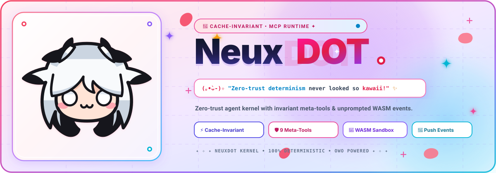
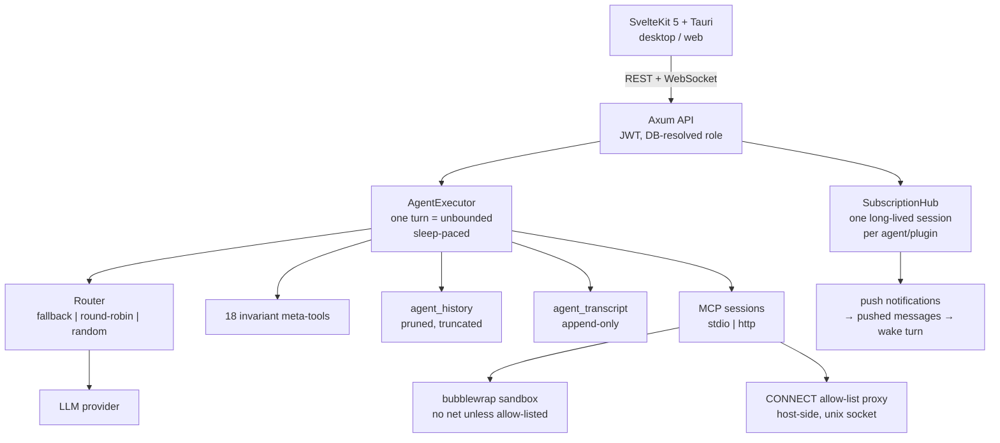

<div align="center">



<br/>

[](https://www.rust-lang.org/)
[](https://tauri.app/)
[-FF3E00.svg?style=for-the-badge&logo=svelte&logoColor=white)](https://svelte.dev/)
[](https://www.sqlite.org/)
[](https://modelcontextprotocol.io/)
[](LICENSE)
[](#-the-philosophy)

<br/>

> ### (｡•̀ᴗ-)✧ *The prompt prefix stays still. Everything else moves.*
>
> NeuxDOT is a single-binary agent runtime: one Rust server, one SQLite file,
> every external capability behind MCP. The agent talks to the world through a
> **fixed 18-tool surface** so the cached prompt prefix survives; the world
> changes underneath it. Plugins are sandboxed by default, permissions are
> per-plugin and per-agent, and nothing is silently discarded.

<br/>

**[ Philosophy ](#-the-philosophy)** &nbsp;•&nbsp;
**[ Architecture ](#-architecture)** &nbsp;•&nbsp;
**[ The 18 Tools ](#-the-18-tools)** &nbsp;•&nbsp;
**[ Plugins ](#-plugins)** &nbsp;•&nbsp;
**[ Memory ](#-two-memories-deliberately)** &nbsp;•&nbsp;
**[ Security ](#-security-model)** &nbsp;•&nbsp;
**[ Quick Start ](#-quick-start)** &nbsp;•&nbsp;
**[ Status ](#-status-honest-section)** &nbsp;•&nbsp;
**[ Authoring ](#-authoring-a-plugin)**

<br/>

</div>

---

## 🧭 The Philosophy

Most agent frameworks fail in the same place: they put **volatile things in a
stable place**. Tool schemas, server status, the memory blob, a new preset —
all shoved into the system prompt. Every change invalidates the LLM's prefix
cache, so every turn re-processes the whole prompt. You pay for the same tokens
twice, then three times, and latency climbs.

NeuxDOT is built on four rules. They are not slogans; each one maps to code you
can read.

### 1. The prompt is a cache key. Treat it like one.

The system prompt contains exactly three things: the agent's instruction text,
its memory block, and the list of enabled tool *names*. External tool schemas
never appear — the model calls `search_tools` → `get_tool_schema` → `call_tool`
to fetch them on demand. Adding a plugin does not change the prompt.

What *does* change it, and is therefore an explicit, rare event:

| Change | When the cached prefix is invalidated |
| :--- | :--- |
| Instruction text / preset changed | next turn (row 0 is re-rendered in place) |
| `instructionsWrite` / `instructionsEdit` | **at the next `compact`**, not immediately |
| Plugin enabled/disabled | next turn (the `{{tools.preset}}` list changes) |
| Nothing else | never |

That last row is the useful part. Conversations are *not* mutated to reflect a
new instruction mid-flight; `compact` is the designated rebuild point, so a
running agent keeps a warm cache until it is genuinely time to rebuild.

Concretely, the system instruction + memory block is rendered **once** and
persisted as row 0 of `agent_history`. It is then carried as the conversation
prefix, not re-appended. It is re-rendered only in three places: an empty
history (new session), a changed instruction template, or `compact`. A test
(`system_prompt_stability_test.rs`) captures two consecutive provider requests
and asserts exactly one system message, byte-identical between turns.

> Side effect worth knowing: `{{time}}` and `{{context_remaining}}` are frozen
> at render time, because re-rendering them every turn is precisely what would
> break the prefix cache. Read the live values from the `ctx:N%` header on tool
> results instead.

> **Honest caveat:** the memory block is embedded in the system prompt, so
> editing it *does* eventually invalidate the prefix. NeuxDOT's claim is
> "stable across an ordinary turn", not "memory is free". `memoryNode*` exists
> partly so you can record facts without touching the block.

### 2. History has two speeds. Keep both.

| | `agent_history` | `agent_transcript` |
| :--- | :--- | :--- |
| Purpose | the live context sent to the LLM | immutable long-horizon record |
| Mutation | pruned + compacted | append-only; no delete/update path exists |
| Fidelity | head/body/tail truncated | full |
| Ordering | `created_at`, `rowid` | `seq` (monotonic per agent) |
| Extra | — | `origin`, `turn`, `metadata_json` |

Nothing a model can no longer see is lost: every truncated payload can be paged
back with `history_inspect`, and searched with `history_search`. Truncation is
self-describing (`<<truncated:FROM-TO>>`) and carries a continuation handle, so
"the output was cut" is never ambiguous.

Pruning removes **whole tool-call groups**. An assistant message with
`tool_calls` always keeps one `tool` reply per id, because a half-group is
rejected by every provider.

### 3. Deny by default, then make consent legible.

A plugin declares what it needs in its manifest. A stored per-account decision
can **narrow** it and never widen it. `elevated` (run on the host, no sandbox)
can only come from the manifest, and is shown with an amber warning at install.

```
manifest declares  ──►  account consent narrows  ──►  effective grants
   (what it wants)        (what you allow)            (what it gets)
```

The same shape drives three surfaces: the consent editor, the sandbox launcher,
and the MCP-App UI bridge. One permission object, one deserializer, one meaning.

### 4. Silent degradation is a bug, not a fallback.

The codebase has an explicit rule: **never report success for a write that did
not happen.** `setMemory` propagates a DB error instead of returning
`{"success": true}` over a discarded result. `search_tools` reports
`plugins_unavailable` instead of an empty list when a plugin failed to answer.
`compact` reports the memory hash it actually installed. Truncation always
leaves a marker. Where the system cannot be certain, it says so.

### 5. A turn is a lifetime, not a request.

There is **no iteration cap**. `run_turn` loops until the agent decides it is
done, it yields to a queued batch, or a fatal error occurs. An agent is expected
to run for hours or days: it works, calls `sleep`, wakes on its own timer or on
a push event, and continues in the same turn. `sleep` is a yield point inside
the loop — it blocks the turn, is interruptible, and does not end it.

**One turn per agent.** Messages that arrive mid-turn are purely additive: they
are held and merged into a single batch (`runtime/turn_queue.rs`), which runs as
the next turn once the current one finishes. The running turn is never
cancelled, interrupted or duplicated. This matters: previously two concurrent
turns each called `sleep`, and each new timer cancelled the other, producing an
endless `SLEEP 30m → WAKE cancelled: superseded by new timer` ping-pong.

Because a turn can be unbounded, "when it finishes" needs a boundary: `sleep` is
that boundary. When a sleep completes and queued work is waiting, the turn ends
so the batch can run next. The sleep is never cut short — it runs its full
duration, then yields. Ownership is a token with a drop guard, so a turn that
unwinds still releases the agent.

The only guard is a liveness one, not a work cap: if a tool-only agent replies
with prose **5 times in a row** without calling any tool, the turn aborts loudly
rather than re-feeding the same rejection forever. Any tool call (including
`sleep`) resets that counter, so real long-horizon work is never truncated.

---

## 🏛️ Architecture

One server process. One SQLite file. Three crate boundaries.



```
src/core/neuxdot-core/     runtime kernel
  db/                      schema.rs (types) · repos.rs (all SQL) · seed.rs
  runtime/                 executor.rs · meta_tools.rs · router.rs · timer_manager.rs
  mcp/                     stdio · http · custom_tools · sandbox · proxy
  auth/                    JWT (30d) + Argon2
src/core/neuxdot-server/   Axum routes, middleware, subscriptions
src/apps/web/              SvelteKit 5 (runes) + Tailwind
src/apps/desktop/          Tauri v2 shell
built-in-plugin/           chat · computer · gitlab · telegram · discord
docs/                      PLUGIN_CONTRACT.md · HOST_BRIDGE.md
```

**Request path, in one line:** `POST /api/agents/:id/run` → `AgentExecutor::run_turn`
→ load history → spawn MCP sessions → loop { call model → dispatch meta-tools →
repeat } → persist to working history *and* transcript.

### The data plane

20 tables. The load-bearing ones:

| Table | Role |
| :--- | :--- |
| `agents`, `agent_providers` | identity, model bindings |
| `agent_history` | working context (mutated) |
| `agent_transcript` | append-only archive (`seq`, `origin`, `turn`) |
| `agent_memories` | the single instructions block (≤ 5,000 chars, hash-guarded) |
| `agent_memory_nodes` / `agent_memory_links` | keyed wikilink graph + edges |
| `mcp_servers`, `agent_mcp` | plugins and per-agent bindings/overrides |
| `agent_tool_permissions` | per-tool enable/disable |
| `agent_subscriptions`, `agent_pushed_messages` | push streams and their queue |
| `agent_shares` | owner / edit / manage-shares / view |
| `accounts`, `profiles` | auth and display data |

---

## 🎀 The 18 Tools

The model's entire permanent surface. Everything else is fetched on demand.

**Discovery (4)** — the cache-stability trick

| Tool | Does |
| :--- | :--- |
| `search_tools` | substring match over name/description; reports `plugins_unavailable` when a plugin failed |
| `get_tool_schema` | full JSON Schema *only* for the tool you asked about |
| `call_tool` | executes; optional per-call `head`/`body`/`tail` budget |
| `list_servers` | plugin list with live `active` status |

**Instructions block (3)** — one text blob, re-injected into the prompt

| Tool | Does |
| :--- | :--- |
| `instructionsWrite` | replace the ≤ 5,000-char block; needs `currentHash` |
| `instructionsEdit` | search-and-replace; needs `currentHash` |
| `instructionsRead` | full text + hash |

**Memory graph (5)** — keyed nodes linked with `[[wikilinks]]`

| Tool | Does |
| :--- | :--- |
| `memoryNodeWrite` | create/replace a node (`entity · decision · preference · event · file · concept · skill`) |
| `memoryNodeRead` | one node + outbound links + backlinks |
| `memoryNodeSearch` | key matches first, then description, then value |
| `memoryNodeList` | cheap graph overview with degree |
| `memoryNodeDelete` | retract a stale fact (hash-guarded) |

**Skills (2)** — reusable procedures stored as `type: "skill"` nodes

`skillWrite`, `skillList`

**Context control (1)**

| Tool | Does |
| :--- | :--- |
| `compact` | rebuild working context, re-render the system instruction, keep the transcript. The only place a changed preset goes live. |

**Time (1)**

| Tool | Does |
| :--- | :--- |
| `sleep` | `30s`/`1m`/`1h30m`/`1d`, no hard cap. **Blocks inside the turn** (it is the agent's yield point, not a turn end), interruptible by a new turn or a push event. The timer registry is process-local, so a restart drops a pending wake. |

**Archive (2)** — for text the model can no longer see

`history_search` (regex over transcript) · `history_inspect` (exact character
range of one entry)

> **Two memories, deliberately.** `instructions*` is one hash-guarded blob
> re-injected every turn — an editable second instruction set. `memoryNode*` is
> an Obsidian-style graph where each node is independently versioned. Their
> hashes are unrelated: a hash from one is never valid for the other.

Every tool result is prefixed with a context header
(`2026-11-02T07:49:33.124Z ctx:30%`), and every truncation carries
`<<truncated:FROM-TO>>` plus a `history_inspect(id=…)` handle.

---

## 🧩 Plugins

One abstraction, five transports. The agent never knows which one it is.

| Transport | Runs | Process | Network default |
| :--- | :--- | :--- | :--- |
| `stdio` | native MCP server over stdin/stdout | yes, **bubblewrap-sandboxed** | **denied** |
| `binary` | same, installed under `data/binaries/` | yes, sandboxed | **denied** |
| `http` | remote MCP server (+ SSE push stream) | no | unrestricted (endpoint-scoped) |
| `custom_tools` / `curl` | declarative HTTP tools evaluated in-process | no | unrestricted |
| `wasm` | *reserved, see [Status](#-status-honest-section)* | — | — |

### What the sandbox actually is

`bwrap --unshare-all`: user, pid, net, ipc, uts, cgroup and mount namespaces.

| Resource | Visible? |
| :--- | :--- |
| `/usr` | read-only (carries `/bin`, `/lib`, `/lib64`) |
| `/etc` | only `ssl`, `ca-certificates`, `resolv.conf`, `hosts`, `nsswitch.conf`, `passwd`, `group`, `ld.so.cache` |
| `/home`, `/root` | **no** |
| `/tmp` | private tmpfs |
| `/workspace` | the **only** writable path (`$HOME`, cwd) |
| Network | **nothing**, unless granted |

When `network.allow` is a non-empty list, the host starts a CONNECT proxy on a
unix socket, binds it into the sandbox, and a `socat` relay listens on
`127.0.0.1:41873`; the plugin gets `HTTP(S)_PROXY`/`ALL_PROXY` pointing at it.
The proxy is the only route out. It refuses unlisted hosts with `403` and a
named reason. `localhost`/IP literals/CIDRs are matched by the same
`NetworkPermissions::allows_host` used by the consent UI.

### Server Control — installed, not configured by you

The server ships an MCP endpoint that lets an agent drive NeuxDOT itself
(`POST /api/control/mcp`, JSON-RPC over HTTP, HTTP Basic auth). On boot the
server seeds a **Server Control** plugin per account, pinned to its own
loopback URL, bound to that account's agents.

Its row carries **no credential**. The `Authorization: Basic …` header is set
**per agent** through the plugin's Auth/Config button, so each bot acts as its
own account and a least-privilege account can be issued per agent. Without an
override the endpoint answers `missing Authorization header` — inert by default.

22 tools, namespaced `server_*`, gated per resource by `permissions.control`
(`agents_read/write`, `shares`, `plugins_read/write`, `providers_read/write`,
and `accounts`, which is **root-only and off by default**). Two gates apply:
the credential's own account + sharing rules, then the declared scopes. Secrets
are never returned: `api_key` becomes `has_api_key: true`, and plugin
`headers_or_env` is never echoed.

---

## 🧠 Two memories, deliberately

The distinction that caused a real agent to file a false bug report, so it gets
its own section.

```
instructionsWrite/Edit/Read          memoryNodeWrite/Read/Search/List/Delete
─────────────────────────────        ──────────────────────────────────────
one text block, ≤ 5,000 chars        any number of keyed nodes
re-injected into the prompt          never inlined; read on demand
SHA-256 of the whole block           a hash per node
changes the prompt prefix            changes nothing until you read it
"standing orders"                    "what I know"
```

`compact` reports the **block** hash. Feeding that hash to `memoryNodeWrite`
is the mistake the names were designed to make impossible.

The graph is rendered in the UI as a force-directed view
(`MemoryGraph.svelte`): type-coloured (`skill`, `entity`, `person`, `project`,
`note`, `preference`), capped at 120 rendered nodes so it stays readable,
clickable for value + outbound + backlinks. `GET /api/agents/:id/memory/graph`
returns edges including dangling targets.

---

## 🛡️ Security model

* **Authorization is DB-authoritative.** The role is resolved from `accounts` on
  every request; the 30-day JWT is never trusted for privilege. A demoted user
  loses root immediately.
* **Sharing is first-class.** Capability checks go through
  `load_agent_with_access` → `require_edit` / `require_manage_shares`. Never
  `account_id == owner_id`.
* **Guardrails:** the last root cannot be demoted or deleted; nobody may delete
  their own account.
* **Plugin consent** is the grouped `PluginPermissions` object, deny-by-default.
  A stored override can narrow, never widen; `elevated` is manifest-only.
* **MCP-App UIs** run in `<iframe sandbox="allow-scripts">` — an opaque origin.
  Messages are authenticated by `event.source`, never `event.origin`. Ungranted
  identity fields are **omitted**, not blanked.
* **Secrets stay server-side.** Provider keys are redacted to `has_api_key`;
  plugin env is never echoed; `control_*`/`server_*` reads never reveal tokens.

Two known sharp edges, stated plainly:

1. A per-agent control credential is stored in `agent_mcp.config_override` in
   plaintext. Use a dedicated account, not `root`.
2. A provider's effective `api_key` is redacted in `server_list_plugins` /
   provider tools, but the value still lives in `providers.api_key` on disk.
   Protect the SQLite file.

---

## 🚀 Quick Start

```bash
# prerequisites: Rust 1.80+, Node 20+ / pnpm, SQLite3, bubblewrap, socat
git clone https://github.com/Neuxbane/NeuxDOT.git
cd NeuxDOT
pnpm install
```

**Web mode** — two terminals:

```bash
cargo run -p neuxdot-server          # API on :8000, prints the root password once
pnpm --filter web dev                # UI on :5173
```

**Desktop:**

```bash
pnpm --filter web tauri dev
```

**Release build:**

```bash
./compile.sh --server --linux --plugins   # -> release/
```

The server reads `DATABASE_URL` (default `sqlite:data/neuxdot.sqlite?mode=rwc`)
and `PORT` (default `8000`). On first boot it prints a generated root password
— save it, it is derived once and not shown again.

---

## 📊 Status (honest section)

What is real today, and what is a placeholder. This section exists so the rest
of the README can be trusted.

| Area | State |
| :--- | :--- |
| 18 meta-tools, dual history, truncation + inspect | **implemented** |
| Keyed memory graph + wikilink edges + UI view | **implemented** |
| sandbox + allow-list proxy + per-agent control | **implemented** |
| stdio / binary / http / custom_tools transports | **implemented** |
| 5 built-in plugins (chat, computer, gitlab, telegram, discord) | **implemented** |
| per-plugin consent, MCP-App host bridge, storage KV | **implemented** |
| **WASM / Wasmtime extensions** | **not implemented** — the `extensions` table, `wasm_binary` column and `wasm` transport name exist as scaffolding only. No Wasmtime dependency, no host ABI, no runner. Do not rely on it. |
| `sleep` persistence | **process-local** — a restart drops pending wakes |
| unbounded turn length | **implemented** — no iteration cap; a turn runs until the agent stops, yields to a queued batch, or trips the 5-text-reply liveness guard |
| one turn per agent + batching | **implemented** — mid-turn arrivals merge into the next turn (`runtime/turn_queue.rs`) |
| automatic compaction | silent group prune; no model-written summary |
| agent-to-agent messaging | **absent** — `server_*` can configure an agent, not converse with it |

Test footprint: **186 tests** across core + server (`cargo test --workspace`).

---

## 🛠️ Authoring a plugin

The full contract is [`docs/PLUGIN_CONTRACT.md`](docs/PLUGIN_CONTRACT.md). The
short version: implement MCP over stdio or HTTP.

```
initialize            → protocolVersion "2024-11-05"
tools/list            → [{ name, description, inputSchema }]
tools/call            → { content: [{ type:"text", text }], isError }
resources/list        → [{ uri, name, mimeType }]     (optional)
resources/subscribe   → push notifications/resources/updated
```

Host conventions that will bite you if you skip them:

* **stdout is the protocol.** Logs go to stderr. One JSON-RPC message per line.
* **Tool names are namespaced** as `<alias>.<tool>`, and a redundant `<alias>_`
  prefix is stripped: alias `telegram` + tool `telegram_send_message` renders as
  `telegram.send_message`.
* **`_sender_account_id` / `_sender_username`** are stamped onto every
  `tools/call`. Trust them for attribution; never treat them as a grant.
* **Persist under `/workspace`**, not `/tmp` (tmpfs, wiped) and not `/home`
  (does not exist).
* **Honour `HTTP(S)_PROXY`.** A client that opens raw TCP reaches nothing —
  the sandbox has no route except loopback.

Ship a manifest with the minimum grants; the consent UI shows exactly what you
asked for.

```json
{
  "name": "My Plugin",
  "permissions": {
    "network": { "allow": ["api.example.com"] },
    "ui": { "enabled": true, "resources": ["ui://my-app"] },
    "storage": { "get": true, "set": true, "delete": false, "keys": ["myapp."] }
  }
}
```

MCP-App UIs follow [`docs/HOST_BRIDGE.md`](docs/HOST_BRIDGE.md): `ui/initialize`,
`host/call` with a capability, `tools/call` forwarded to the plugin, and an
omission rule for ungranted identity.

---

## 🧪 Testing

```bash
cargo test --workspace          # 186 tests
pnpm --filter web check         # svelte-check
pnpm --filter web build         # production bundle
```

The suite pins invariants that have failed before: tool-set shape and order,
sandbox argv (no `/home`, no `--share-net` unless granted), proxy allow/deny,
history repair, prompt-prefix preservation across compaction, and that a
network grant actually reaches `SandboxSpec::launch_for`.

---

## 🤝 Contributing

[`AGENTS.md`](AGENTS.md) is the working contract for humans and AI agents alike.
Two rules from it worth repeating:

1. **Never invent an API.** If a route, repo method or column does not exist,
   say so — do not add a speculative stub.
2. **Verify, don't assume.** "Should work" is not a result.

---

<div align="center">

```text
✧･ﾟ: *✧･ﾟ:* 🌸 *:･ﾟ✧*:･ﾟ✧ ─── ･ ｡ﾟ☆: *.☽ .* :☆ﾟ. ─── ✧･ﾟ: *✧･ﾟ:* 🌸 *:･ﾟ✧*:･ﾟ✧
```


### (◕‿◕✿) Stay deterministic, stay kawaii.

MIT licensed.

</div>
