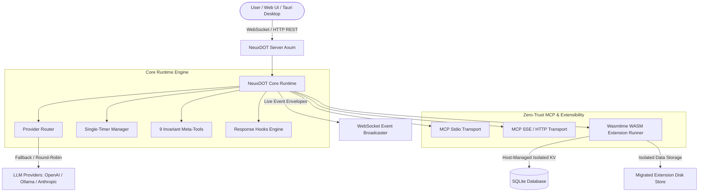

<div align="center">

# 🌌 NeuxDOT

**Autonomous, Cache-Invariant, Zero-Trust MCP-Native Agent Runtime & Desktop Platform**

[](https://www.rust-lang.org/)
[](https://tauri.app/)
[-FF3E00.svg?style=flat-square&logo=svelte)](https://svelte.dev/)
[](https://wasmtime.dev/)
[](https://www.sqlite.org/)
[](LICENSE)

*Built for developers who demand deterministic prompt caching, zero-trust tool security, unprompted asynchronous event streaming, and sandboxed WebAssembly extensibility.*

---

</div>

## ⚡ The NeuxDOT Paradigm

Traditional agent frameworks inline dynamic JSON schemas and unpredictable system state into every prompt, breaking LLM prompt prefix caches and causing massive latency spikes and token costs. 

**NeuxDOT solves this at the runtime kernel level:**

* **100% Cache Invariance**: The agent system prompt and tool definitions remain static across turns. External tool specifications are discovered on-demand via invariant meta-tools.
* **Zero-Trust Tool Discovery**: Tools and MCP endpoints disabled by policy are completely invisible to the LLM. No prompt leakage.
* **Unprompted Push Subscriptions**: True asynchronous MCP event streams (`notifications/resources/updated`) push real-time data into context without polling.
* **Sandboxed WASM Extensions**: Safe, isolated WebAssembly extensions running via Wasmtime with host-managed Key-Value stores and persistent storage migration.
* **Deterministic Single-Timer Sleeping**: Native interruptible `sleep(duration)` with timer supersedence and clean event wakeups.
* **Pure Handlebars Templating**: No hardcoded system prompt injections. Complete user control over prompt structure and memory formatting.
* **Transparent Response Hooks**: Custom messages evaluated with `{{time}}` and `{{context_remaining}}` injected into every tool execution event.

---

## 🏛️ System Architecture



---

## 🎯 Key Features

### 1. 🛡️ 9 Invariant Meta-Tools (Cache-Stability Guarantee)
NeuxDOT never pollutes prompt prefix caches with raw JSON schemas. Instead, the model interacts through 9 invariant meta-tools:

| Meta-Tool | Purpose | Invariant Behavior |
| :--- | :--- | :--- |
| `search_tools` | Search external MCP tools by keyword | Zero-trust filtered |
| `get_tool_schema` | Fetch input parameter specifications on-demand | Dynamically pulled |
| `call_tool` | Execute verified external MCP tools | Validated parameters |
| `list_servers` | Inspect connected MCP servers and statuses | Live connectivity check |
| `setMemory` | Overwrite persistent agent memory with SHA-256 verification | Optimistic concurrency lock |
| `editMemory` | Surgical search-and-replace update to memory | Protected by hash matching |
| `readMemory` | Retrieve current untruncated memory content and hash | Integrity safe |
| `compact` | Prune running history to prompt and current memory | Reduces buffer overhead |
| `sleep` | Pause execution for human-readable durations (`1m`, `30s`, `2h`) | Interruptible via events |

### 2. 🧩 Sandboxed WebAssembly (WASM) Extensions
Extend agent capabilities safely with pre-compiled WebAssembly:
* **Isolated Host-Managed Storage**: Each extension gets a dedicated Key-Value namespace and isolated filesystem sandbox in `data/<wasm_hash>/`.
* **Zero-Downtime Data Migration**: Updating an extension automatically migrates existing storage files to the new build and removes stale directories.
* **Manifest Inspection Modal**: Preview incoming tool definitions, UI panels, and storage requirements before committing updates.

### 3. 🪝 Transparent Response Hooks & Strict Handlebars
Template variables are structured cleanly with no hardcoded prompt injections:
* `{{agent.name}}`: The agent's name.
* `{{agent.id}}`: Agent UUID.
* `{{agent.memory}}` / `{{agent.memory.content}}`: Persistent memory content.
* `{{agent.memory.hash}}`: SHA-256 integrity hash of memory.
* `{{tools.preset}}`: Comma-separated list of enabled tool names.
* `{{time}}`: Current local timestamp (e.g. `2:45 PM`).
* `{{context_remaining}}`: Remaining characters before reaching buffer limit.

**Response Hooks** can be registered by users or extensions to inject contextual telemetry into every tool result returning to the model:
```
{"content":[{"text":"Message sent","type":"text"}]}

[Response Hook]
Current time: 2:45 PM | Buffer remaining: 294,820 chars
```

### 4. 📜 Running History Buffer & Auto-Pruning
* Configurable `max_running_history_chars` per agent (defaults to **300,000** characters).
* Real-time monitoring in the dashboard.
* Runtime executor automatically trims the oldest conversation turns while strictly preserving the foundational system prompt.

---

## 🚀 Quick Start

### Prerequisites
* **Rust** 1.80+ ([Install Rust](https://www.rust-lang.org/tools/install))
* **Node.js** 20+ & **pnpm** ([Install pnpm](https://pnpm.io/))
* SQLite3

### 1. Clone & Install
```bash
git clone https://github.com/NeuxDOT/NeuxDOT.git
cd NeuxDOT
pnpm install
```

### 2. Run the Full Stack in Development

#### Option A: Web Mode (Server + SvelteKit Frontend)
```bash
# Terminal 1: Start the Rust backend server (port 8000)
cargo run -p neuxdot-server

# Terminal 2: Start the modern SvelteKit web client
pnpm --filter web dev
```
Open [http://localhost:5173](http://localhost:5173) in your browser.

#### Option B: Native Desktop App (Tauri v2)
```bash
pnpm --filter web tauri dev
```

---

## 🛠️ Building WASM Extensions

NeuxDOT extensions compile directly to `wasm32-unknown-unknown` without heavy runtime dependencies.

See the included **Agent Chat Console** extension in [`examples/chat-extension/`](examples/chat-extension/):

```bash
# Compile the example extension
cargo build --release --target wasm32-unknown-unknown \
  --manifest-path examples/chat-extension/Cargo.toml

# Upload the resulting binary via the NeuxDOT Settings UI:
# target/wasm32-unknown-unknown/release/chat_extension.wasm
```

### Extension Host ABI Interface
Extensions can declare host imports for logging, isolated storage, and unprompted background execution:
```rust
#[link(wasm_import_module = "env")]
extern "C" {
    fn host_log(msg_ptr: *const u8, msg_len: usize);
    fn host_kv_get(key_ptr: *const u8, key_len: usize, out_ptr: *mut u8, max_out: usize) -> i32;
    fn host_kv_set(key_ptr: *const u8, key_len: usize, val_ptr: *const u8, val_len: usize) -> i32;
    fn host_fs_write(path_ptr: *const u8, path_len: usize, data_ptr: *const u8, data_len: usize) -> i32;
    fn host_agent_run_background(agent_id_ptr: *const u8, agent_id_len: usize, input_ptr: *const u8, input_len: usize) -> i32;
    fn host_get_time_str(out_ptr: *mut u8, max_out: usize) -> i32;
}
```

---

## 🧪 Testing & Verification

NeuxDOT includes an extensive integration test suite covering meta-tools, prompt interpolation, memory hashing, WASM runners, timer invariants, and zero-trust permissions:

```bash
# Run all workspace unit and E2E integration tests
cargo test --workspace

# Validate web client TypeScript and Svelte runes
pnpm --filter web check

# Verify production frontend bundle
pnpm --filter web build
```

---

## 📂 Repository Structure

```
.
├── apps/
│   └── web/                # SvelteKit 5 (Runes) frontend + Tailwind CSS
├── crates/
│   ├── neuxdot-core/       # Core runtime engine, MCP client, WASM runner, memory
│   └── neuxdot-server/     # Axum REST & WebSocket streaming server
├── examples/
│   └── chat-extension/     # Reference WASM extension (Chat Console & unprompted turns)
├── src-tauri/              # Tauri v2 desktop shell
├── Cargo.toml              # Cargo workspace manifest
├── pnpm-workspace.yaml     # PNPM monorepo workspace configuration
└── .gitignore              # Security-first ignore rules (zero-data leakage)
```

---

## 🔒 Security & Privacy

* **Zero-Leakage Guarantee**: `.sqlite` files, runtime chat logs, extension storage caches, and `.env` files are strictly excluded from version control.
* **Sandboxed Execution**: WASM extensions have no direct access to system memory, sockets, or host files outside their provisioned `data/<hash>/` directory.
* **Zero-Trust Tool Discovery**: Tools cannot be called unless explicitly authorized on an agent level.

---

## 📜 License

Licensed under the [MIT License](LICENSE).
